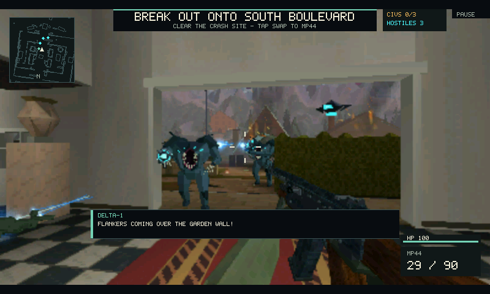
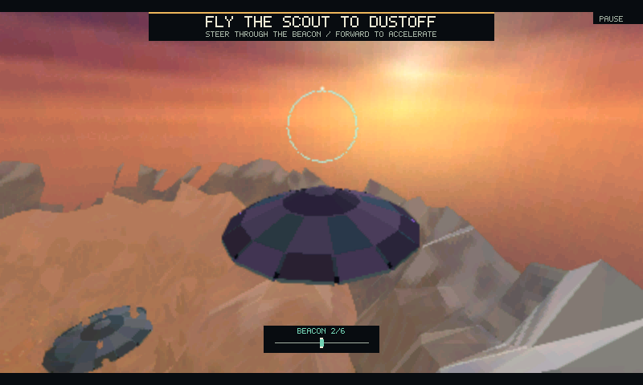
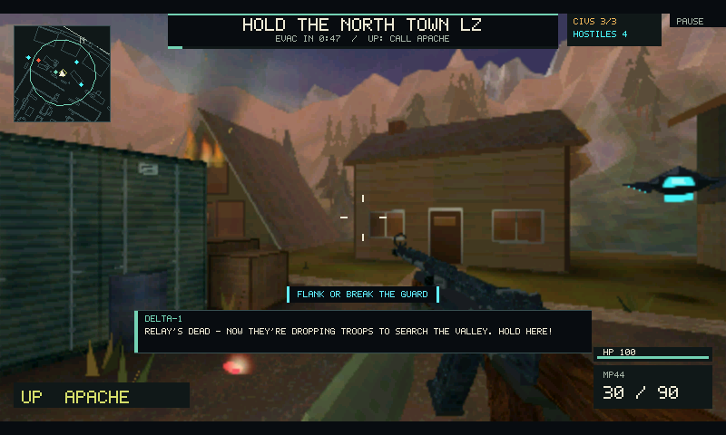
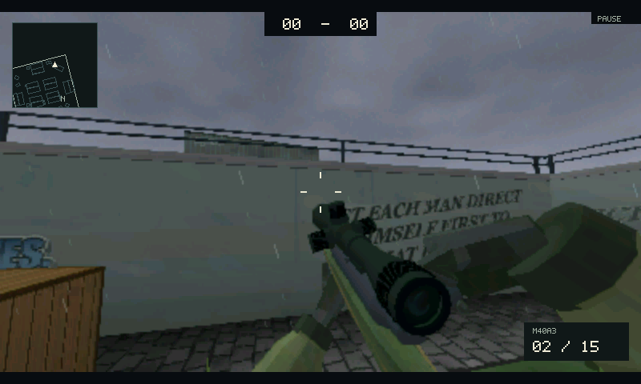
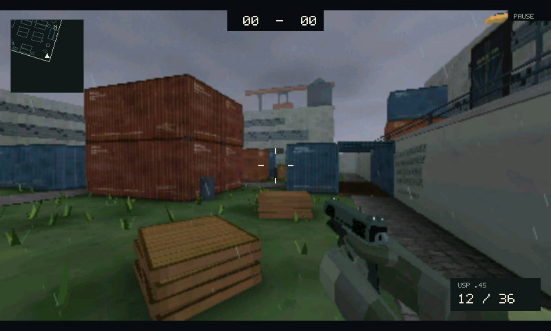
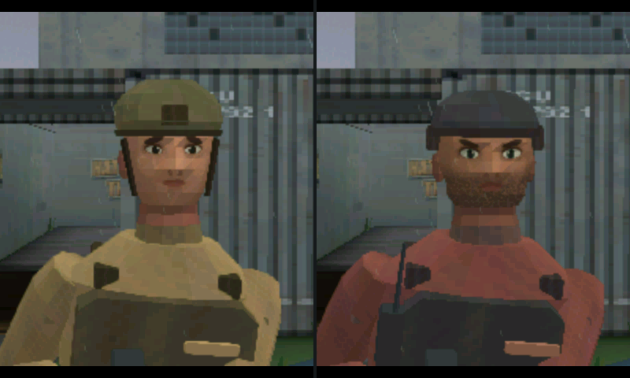
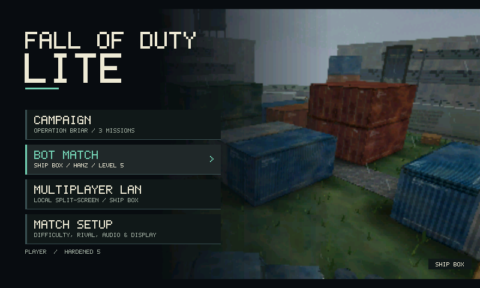

# Fall of Duty Lite

**An offline, software-rendered first-person shooter for the ESP32-P4 handheld and SDL2 desktops** — packing a three-mission alien-invasion campaign, 1v1 and three-way bot matches, and local split-screen duels into a **4.00 MB** core game pack, plus a **3.38 MB** optional voice bank (**7.38 MB** total on SD for the full voiced campaign).

- **Core SD pack (`fall-of-duty.fodp`):** `4,001,984 bytes` (**4.00 MB**) ([manifest](assets/fall-of-duty.fodp.json)) — complete game & playable 3-mission campaign with subtitles, **4.6% smaller than the Doom v1.9 shareware WAD** ([reference](https://github.com/viti95/FastDoom/blob/master/README.txt))
- **Voiced campaign bank (`campaign-voices.fodv`):** `3,379,439 bytes` (**3.38 MB**) ([manifest](assets/campaign-voices.fodv.json)) — 104 spoken lines across five voices, loaded only during Campaign (**7.38 MB** combined on SD)
- **Targets:** Guition `JC4880P443C_I_W` (ESP32-P4, 800×480 display, wired DualShock 4) and macOS / Linux / Windows SDL2 desktops

[Operation Briar](#operation-briar-campaign) · [Play on Desktop](#play-on-desktop) · [Controls](#controls) · [Screenshots](#screenshots) · [Handheld Setup](#handheld-download-and-hardware) · [Verification & Benchmarks](#verification-and-testing)


---

## Three ways to play

- **Operation Briar (Campaign)** — A three-mission story set across the Colorado Front Range on Day One of an alien landing. Sweep a mist-covered mountain town, use the invaders' homing signal to ground the fleet, then seize a scout ship and fly it back for recovery.
- **Bot Match (1v1 & Free-for-All)** — First to ten in **Ship Box** (a rain-soaked container yard) or **Briar House** (a two-lobby mansion with covered flanks). Face **IPwndUrMom**, **Hanz**, or both at once across difficulty levels 1–10 (default 5), complete with UAV radar (3 kills), targeted Airstrike laptop (5 kills), Apache gunship support (7 kills), and 27 voiced rival taunts.
- **Local Two-Player Duel (Desktop)** — Plug in two SDL gamepads and run `--local-duel` for 60 fps split-screen matches on either arena.

---

## Operation Briar campaign

Choose **Campaign** on the title screen. On desktop, choose **Solo Campaign** or **2 Player Co-op**. Choose the flight or mission listed on the results screen to carry your time and survivor outcomes forward.

In desktop co-op, two gamepads control two operatives in the same campaign. Alien patrols and reinforcements double, with room for up to eight active aliens. Player 1 handles scripted interactions and pilots the scout. Player 2 can fight independently and hold **L1 / LB** during the scout flight to reduce crosswind. A downed player rejoins near their partner after five seconds if the partner stays alive. If both go down, use the shared checkpoint retry on the results screen.

> **The premise:** The alien fleet came down on Briar House because Dr. Nora Marsh's rooftop radio array was transmitting. *Warhorse 2-1* was shot down on final approach to extract her family. The campaign follows what she — and Delta Squad — do with that signal.

| Mission 1 — Briar House breakout | Mission 3 — The Array finale |
| --- | --- |
|  |  |

### The three missions

1. **Briar House** — Wake up concussed in the Grand Hall after Delta-1 drags you clear of the burning wreck. Break through the patrol on South Boulevard and search the three rescue districts in any order.
   - **East Ridge (Ben):** Clear the patrol covering Ben’s pickup and wave him across when he has a clear run. Signal too early and he draws fire and ducks back.
   - On **North Valley Avenue**, an Enforcer shields itself from the front while pinning Nora. Flank it, crack the guard with sustained fire, or use the opening when Nora’s dish pulses. Destroy the receiver on this visit to North Avenue.
   - In **West Timberline**, Walt waits at the western approach to the clearing. Crouch beside him to follow his covered route toward Dustoff’s flares, or clear the patrol and let him move on his own.

   Once the family is accounted for and the receiver is down, hold **North Town Clearing** with Apache support until **Dustoff-1** lands. Watch for beams from the fleet marking the next landing. Signal the family across when the wall is clear. Nora stays with her dish.

2. **Timberline** — Take Dustoff from Briar House to a remote logging basin. Clear the patrol at the timber shed and hold **Signal** to lure the scout saucer onto two landing spots. Move Nora’s emitter to the quarry for the last two readings and stop the jammer from pulling a drop onto the kit. When the cruiser sends reinforcements, fall back through the hills with the thermal M40A3. Delta-1 spots contacts through the mist. Use the ridge cover to take a shot and move before the next drop cuts you off. At the north saddle, crouch behind the low wall while Dustoff lands. **Signal** at the cabin door to board under pursuit.

3. **The Array** — Retake Briar House through the front portico or east garage. Calibrate the roof dish and take out the jammer from outside. Steal the fleet's landing code at the east bend, set the west repeater, and fight back to the house. Steer the flagship around the North Clearing and put the fleet down beyond the ridge. At the overlook, use Timberline's emitter to ride the last scout's retrieval beam aboard. Reroute cargo to draw out the crew, pair with the transponder, and cut the automatic return link. Claim the helm and follow Dustoff's approach beacons to whichever landing site survived.

### Campaign mechanics & voices

- **One control for everything:** **Signal** (`F`, `L1`, or `LB`) calls people across cover, paints drop zones, and steers the mothership's beam. You cannot fire while holding it; the prompt beneath the reticle shows what it will do.
- **Branching outcomes:** If Nora is lost in Briar House, Delta-1 works from her notes through Timberline and The Array — without her jammer warnings — and the closing lines and epilogues reflect who made it out and whether the clearing survived.
- **Campaign voices and subtitles:** The 104 recorded lines across Delta-1, Nora Marsh, Dustoff-1, Walt Marsh, and Ben Marsh are encoded in `assets/campaign-voices.fodv`. New Mission 3 exchanges appear as subtitles. Keep `campaign-voices.fodv` beside `fall-of-duty.fodp`. Subtitles remain active if the voice bank is missing or **Radio Sound** is muted.
- **Tactical combat:** Enforcers lower their frontal guard before firing. Hit the exposed chest to interrupt a charging cannon. Scout drones sweep with scanners, and jammer drones hover while disrupting the emitter or dish. Blue plasma travels visibly downrange and briefly slows anyone it hits.
- **Checkpoints & Rank S:** Checkpoints save at key transitions and restore civilian outcomes, kills, and time on retry. Rank S on Briar House requires all three civilians saved, zero checkpoint reloads, and a clear time under 5:00.

---

## Crafted for low-resolution software rendering

Everything renders on the CPU — no GPU required — at 400×225 or 320×180 on the handheld (presented at 800×480) and up to **1280×720** on desktop:

- **Enhanced software rasterizer** — Perspective-aware mip blending, diagonal edge smoothing, 16-bit reciprocal depth, dithered sky cubemap, and bilinear scaling (pass `--look classic` on desktop to compare the original flat-lit renderer).
- **Baked daylight & atmosphere** — Loads fast and bakes soft sun shadows and ambient shade directly from arena geometry, with contact shadows, rain haze, dusk valley mist, windblown fire/smoke, and procedural damp/dry surfaces in Briar House.
- **Expressive weapons & motion** — Three weapons (**MP44**, **M40A3**, **USP .45**) with fitted first-person gloves, multi-phase reload and bolt tracks, a distance-driven sprint cycle, turn lag, landing dip, character travel lean, and a banking Apache gunship.
- **Compact audio & storage** — Schema 7 lossless block compression keeps the core pack (`fall-of-duty.fodp`) at `4.00 MB`, while the optional 104-line campaign voice sidecar (`campaign-voices.fodv`) adds `3.38 MB` (`7.38 MB` combined on SD). Both the 27-line rival bank and the 104-line campaign bank stay compressed in IMA ADPCM and decode live during mixing.

See [QUALITY.md](QUALITY.md), [EVIDENCE.md](EVIDENCE.md), and [ASSET_PIPELINE.md](ASSET_PIPELINE.md) for rendering details, measurements, and pack internals.

---

## Screenshots

| Operation Briar — North Town LZ | Ship Box — Bot duel |
| --- | --- |
|  |  |

| MP44 iron sights | M40A3 bolt cycle |
| --- | --- |
|  |  |

| USP .45 grip | IPwndUrMom and Hanz |
| --- | --- |
|  |  |

| Start screen (Ship Box) | Airstrike targeting laptop |
| --- | --- |
|  |  |

---

## Play on desktop

### Build and run

Requires CMake 3.22+, Ninja, a C++17 compiler, zlib 1.2.9+, and SDL2 development files. On macOS, Xcode Command Line Tools provide zlib, and Homebrew installs CMake, Ninja, and SDL2. Both `assets/fall-of-duty.fodp` and `assets/campaign-voices.fodv` are checked in and ready to play.

```sh
cmake -S . -B build/host -G Ninja -DCMAKE_BUILD_TYPE=Release
cmake --build build/host
ctest --test-dir build/host --output-on-failure
build/host/fod_host
```

### Launch modes

```sh
build/host/fod_host                         # Ship Box bot duel (default)
build/host/fod_host --mission briar-house   # Operation Briar campaign
build/host/fod_host --local-campaign       # 2-player Operation Briar split-screen
build/host/fod_host --mission array         # Start Mission 3 at the Warhorse wreck
build/host/fod_host --map briar-house       # Briar House mansion bot duel
build/host/fod_host --local-duel            # 2-player split-screen (two SDL gamepads)
```

- **Display:** Solo renders at **1280×720** by default at 60 fps. Change **Render Size** in Match Setup or the pause menu, or pass `--mode 800`, `--mode 400`, or `--mode 320`. Pass `--look classic` for flat lighting and nearest-neighbor scaling, or `-DFOD_DESKTOP=OFF` to CMake for a headless CLI/test build without SDL2.
- **Local two-player duel:** Connect two SDL-compatible gamepads (an 8BitDo Pro 2 in Switch mode may appear as *Pro Controller*). Press **Start** or **+** on each pad to claim a seat, then press Player 1's confirm button (**B** on the Pro 2). First to ten wins; simultaneous 10–10 is a draw. Renders at 640×360 per view by default (use `--duel-resolution 400` or `--duel-resolution 800` to change).
- **Local campaign co-op:** Connect two SDL-compatible gamepads. Press **Start** or **+** on each pad to join, then confirm on Player 1's pad. Either pad can pause the game. Rejoin and resume if a pad disconnects.

---

## Controls

SDL gamepads mirror the handheld DualShock 4 layout. On desktop, controller play keeps the cursor free; click inside the window in Solo to capture mouse aim, and pause to release it. Losing window focus or disconnecting a controller pauses automatically.

Nintendo-layout controllers (including 8BitDo Pro 2 in Switch mode) default to 80% stick sensitivity; other gamepads default to 100%. Override with `--stick-sensitivity PERCENT` (1–200).

| Action | Keyboard & mouse | DualShock 4 / Xbox | 8BitDo Pro 2 |
| --- | --- | --- | --- |
| Move | `W A S D` | Left stick | Left stick |
| Look / airstrike cursor | Mouse | Right stick | Right stick |
| Fire / mark airstrike | Left click | `R2` / `RT` | `R2` |
| Aim down sights | Right click or `Space` | `L2` / `LT` | `L2` |
| Sprint | `Shift` | `L3` | Left stick press |
| Jump | `Z` | `Cross` / `A` | `B` |
| Crouch (tap) / prone (hold) | `C` | `Circle` / `B` | `A` |
| Reload | `R` | `Square` / `X` | `Y` |
| Swap weapon *(campaign: tap = previous, hold = third)* | `X` | `Triangle` / `Y` | `X` |
| Signal *(campaign)* | `F` | `L1` / `LB` | `L` |
| Deploy killstreak / close laptop | `Up` arrow or `4` | D-pad Up | D-pad Up |
| Confirm / start | `Enter` or click | `Cross` / `A` | `B` |
| Navigate menus | Arrow keys | D-pad | D-pad |
| Back / pause / resume | `Esc` or `P` | `Circle` / `Options` | `A` / `+` |

---

## Handheld download and hardware

### Releases

- **Voiced Operation Briar preview (`7.81 MB` / `7,806,754 bytes`, recommended for Campaign):** [campaign-voices-preview-2](https://github.com/AJ7-III/Fall-of-Duty-Lite/releases/tag/campaign-voices-preview-2) · [Fall-of-Duty-Lite-Guition-ESP32-P4-Campaign-Voices.zip](https://github.com/AJ7-III/Fall-of-Duty-Lite/releases/download/campaign-voices-preview-2/Fall-of-Duty-Lite-Guition-ESP32-P4-Campaign-Voices.zip) · [SHA-256](https://github.com/AJ7-III/Fall-of-Duty-Lite/releases/download/campaign-voices-preview-2/Fall-of-Duty-Lite-Guition-ESP32-P4-Campaign-Voices.zip.sha256) — bundles the ESP32-P4 firmware, `fall-of-duty.fodp` (`4.00 MB`), and `campaign-voices.fodv` (`3.38 MB`) (plus source archive for desktop).
- **Base v1.1.0 handheld release (`4.47 MB`, Ship Box only):** [v1.1.0 release](https://github.com/AJ7-III/Fall-of-Duty-Lite/releases/tag/v1.1.0) · [Fall-of-Duty-Lite-Guition-ESP32-P4.zip](https://github.com/AJ7-III/Fall-of-Duty-Lite/releases/download/v1.1.0/Fall-of-Duty-Lite-Guition-ESP32-P4.zip) · [SHA-256](https://github.com/AJ7-III/Fall-of-Duty-Lite/releases/download/v1.1.0/Fall-of-Duty-Lite-Guition-ESP32-P4.zip.sha256) · [All releases](https://github.com/AJ7-III/Fall-of-Duty-Lite/releases/latest)

Keep the firmware and SD pack from the same archive together. Each release bundles the bootloader, partition table, app binary, SD files, replay traces, `INSTALL.md`, licenses, and `SHA256SUMS`.

### Target hardware

| Component | Target profile |
| --- | --- |
| **Board & SoC** | Guition `JC4880P443C_I_W` with pre-v3 ESP32-P4 silicon (v0.0–v1.99 image range, 360 MHz CPU, 16 MB flash, 200 MHz PSRAM) |
| **Display & touch** | ST7701S DPI panel (800×480 presentation; 400×225 and 320×180 world modes) and GT911 touch for menus and HUD pause |
| **Audio & storage** | ES8311 I²S speaker output and FAT32 microSD over SDMMC (`/sd/fall-of-duty.fodp` + `/sd/campaign-voices.fodv`) |
| **Controller** | Wired Sony DualShock 4 (`VID 054c`, `PID 05c4` or `09cc`) on the P4 high-speed USB host port |

Follow [INSTALL.md](INSTALL.md) to verify `SHA256SUMS`, copy `sd/` to the root of a FAT32 microSD card, check chip/flash IDs with `esptool`, and flash `@flash_args`. Selecting **Campaign** or switching arenas restarts the board into a loading card, builds Briar House (and loads `campaign-voices.fodv` in Campaign mode), and returns to the title screen ready to play.

> [!NOTE]
> Handheld packages are cross-built with ESP-IDF v5.5.3 and checked for flash layout and checksums, while physical Guition `JC4880P443C_I_W` board qualification (live scanout, touch corners, USB gamepad, audio under scanout, and optical latency) remains pending per [BOARD.md](BOARD.md).

---

## Verification and testing

| Area | Status | Summary |
| --- | --- | --- |
| **Native & platform tests** | Verified on desktop | Release and ASan/UBSan builds pass all 6 CTest suites: 1v1 & FFA duels, local split-screen, desktop init failure, scripted 3-mission Operation Briar runs (with and without Nora), voice playback/muting, and checkpoint retries. |
| **Replay parity** | Verified on desktop | 8 browser reference fixtures, `ffa-apache`, and 4 campaign traces, including `scout-takeover`, match byte for byte at 320×180 and 400×225. |
| **Asset memory** | Verified on desktop | Ship Box loads at `9,830,221` resident bytes (`9,912,141` peak, 12 MiB loader limit). The campaign maps and shared assets use `12,557,138` resident bytes plus the `3.38 MB` `campaign-voices.fodv` bank loaded only in Campaign mode. |
| **Desktop benchmarks** | Measured on desktop | Projection reuse cut geometry setup p95 by 29–33% and whole-frame p95 by 1.6–14.6%; low-res art, sprint motion, and campaign voice mixing stay within measurement noise. |
| **ESP32-P4 firmware** | Cross-build validated | ESP-IDF v5.5.3 image and release archive pass partition, flash-layout, and SHA-256 verification; physical hardware run pending ([BOARD.md](BOARD.md#qualification-status)). |

*(Known note: the browser-vs-native `apache` fixture allows a bounded 7 cm vertical root difference on the dead rival at ticks 564–570; see [EVIDENCE.md](EVIDENCE.md#replay-fixtures).)*

### Running tests, replays, and benchmarks

```sh
ctest --test-dir build/host --output-on-failure
build/host/fod_host --bench reference/fixtures/long-lane.fodtrace --mode both
build/host/fod_host --bench reference/fixtures/ffa-apache.fodtrace --mode both
build/host/fod_host --bench reference/fixtures/briar-breakout.fodtrace --mode both
build/host/fod_host --bench reference/fixtures/briar-landing-zone.fodtrace --mode both
build/host/fod_host --bench reference/fixtures/briar-finale.fodtrace --mode both
python3 tools/run-evidence.py \
  --host build/host/fod_host --pack assets/fall-of-duty.fodp \
  --reference reference/fixtures --out out/evidence
```

### CLI options

| Option | Effect |
| --- | --- |
| `--pack PATH` | Load a custom `.fodp` pack (defaults to `assets/fall-of-duty.fodp`; looks beside it for `campaign-voices.fodv`) |
| `--map ship-box\|briar-house` | Launch directly into a Ship Box or Briar House bot match |
| `--mission briar-house` | Launch directly into the Operation Briar campaign |
| `--mission array` | Start The Array with Nora alive |
| `--local-duel` | Start local two-player split-screen (desktop only; pair with `--duel-resolution 400\|640\|800`) |
| `--local-campaign` | Start Operation Briar in local two-player split-screen on desktop |
| `--split-resolution 400\|640\|800` | Set the per-player render width for a local duel or co-op campaign (default 640) |
| `--mode 320\|400\|800\|1280\|both` | Choose render resolution (`800`/`1280` on desktop; `both` runs 320 and 400 during `--bench`) |
| `--look enhanced\|classic` | Select the enhanced renderer or the classic flat-lit renderer |
| `--stick-sensitivity PERCENT` | Set desktop gamepad right-stick sensitivity (`1`–`200`) |
| `--trace PATH` / `--journal PATH` | Replay a `.fodtrace` headlessly and optionally record per-tick JSONL state |
| `--bench PATH` | Measure per-stage timings (`--frames 3000` and `--warmup 300` by default) |
| `--image PATH` | Write an 800×480 PPM frame (pair with `--trace` and `--image-tick N`) |
| `--inspect` | Print JSON asset counts, memory estimates, source revision, and art seed |

---

## Asset export & firmware packaging

### Regenerate the asset pack

Optional export and browser-capture tools require Node.js (20.19+, 22.13+, or 24+) and Playwright Chromium:

```sh
npm ci
npx playwright install chromium
npm run data:check
npm run assets:export
```

The exporter writes `out/sd/fall-of-duty.fodp` (test with `build/host/fod_host --pack out/sd/fall-of-duty.fodp`).

### Package a handheld release

Follow [BOARD.md](BOARD.md) to build `firmware/build-lite` with ESP-IDF v5.5.3, then assemble the release archive from the repo root:

```sh
python3 tools/package-release.py \
  --firmware firmware/build-lite --idf "$IDF_PATH" \
  --sd assets --reference reference/fixtures \
  --out out/Fall-of-Duty-Lite-Guition-ESP32-P4.zip
```

---

## Documentation & attribution

| Document | Contents |
| --- | --- |
| [INSTALL.md](INSTALL.md) | Handheld flashing steps, SD card setup, recovery flow, and DualShock 4 controls |
| [BOARD.md](BOARD.md) | ESP-IDF v5.5.3 build profile, display/input bring-up, on-device benchmarks, and qualification checklist |
| [QUALITY.md](QUALITY.md) | Audio mixing, IMA ADPCM voice banks, daylight baking, and enhanced renderer notes |
| [EVIDENCE.md](EVIDENCE.md) | Compression metrics, memory accounting, desktop benchmarks, and replay parity results |
| [ASSET_PIPELINE.md](ASSET_PIPELINE.md) | Schema 7 pack layout, geometry encodings, and optional browser baseline capture |
| [reference/browser/README.md](reference/browser/README.md) | Included browser snapshot driving asset export and gameplay data generation |

Companion browser project: [Fall of Duty](https://github.com/AJ7-III/Fall-of-Duty). Licensed under the [MIT License](LICENSE); see [THIRD_PARTY_NOTICES.md](THIRD_PARTY_NOTICES.md) for third-party attributions.
