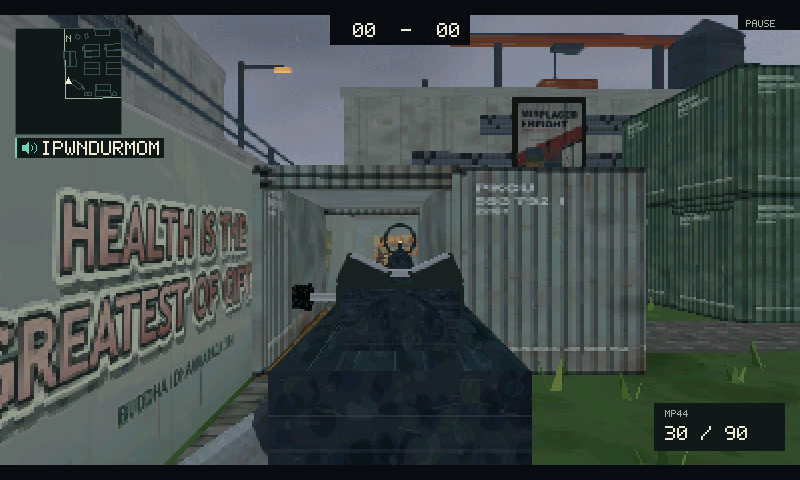
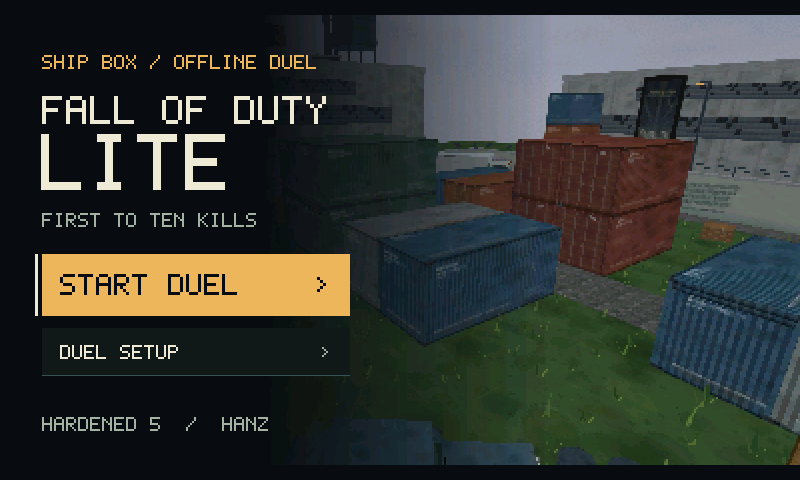

# Fall of Duty Lite

**3.92 MB (3,917,641 bytes)** for the current microSD game pack. [Pack manifest](assets/fall-of-duty.fodp.json)

Fall of Duty Lite is an offline first-person shooter for the Guition JC4880P443C_I_W ESP32-P4 and SDL2 desktops. Fight a first-to-ten match in Ship Box, a rain-soaked container yard. Duel either rival or face both in a three-way free-for-all. Difficulty ranges from 1 to 10 and defaults to level 5. The game renders at 400×225 or 320×180 and presents at 800×480.

The pack is **6.6% smaller than the Doom v1.9 shareware WAD**. [Doom WAD size](https://github.com/viti95/FastDoom/blob/master/README.txt)

[Download v1.1.0 handheld package](https://github.com/AJ7-III/Fall-of-Duty-Lite/releases/tag/v1.1.0) · [Handheld setup](INSTALL.md) · [Play on desktop](#play-on-desktop) · [Board build and qualification](BOARD.md) · [Evidence and benchmarks](EVIDENCE.md)


## Inside Ship Box

- **Three weapons with first-person arms** — Fuller olive sleeves and padded gloves sit close to the camera. The MP44 and USP .45 use subdued steel, and the M40A3 has a painted stock with a tinted scope lens.
- **Distinct faces and field kits** — IPwndUrMom wears sand, Hanz has stubble and wears muted rust and charcoal, and the player wears olive camouflage and raised goggles.
- **Killstreaks and rival voice comms** — Three consecutive kills activate UAV radar. Five unlock a targeted airstrike and seven unlock Apache support. The shared 27-line voice bank decodes mono 24 kHz IMA ADPCM on demand.
- **Ship Box yard** — Green turf and 300 low-poly grass tufts fill the yard between the stone paths. Mild texture sharpening keeps lettering and surface edges legible at both render sizes.
- **Baked daylight** — While the pack loads, the renderer works out soft sun shadows and ambient shade from the yard's own geometry. Containers darken toward the ground, the rival casts a contact shadow, and distant buildings fade into rain haze.
- **Enhanced software renderer** — Perspective-aware mip blending, diagonal edge smoothing, 16-bit reciprocal depth, and a dithered sky cubemap. Desktop `--look classic` runs the earlier renderer for comparisons. [Rendering notes](QUALITY.md)
- **Lossless asset compression** — The schema 7 pack stores independently compressed blocks and decodes them as it loads.

## Handheld download and hardware

The v1.1.0 Guition archive is about **4.47 MB**. [GitHub release](https://github.com/AJ7-III/Fall-of-Duty-Lite/releases/tag/v1.1.0)

- [Fall-of-Duty-Lite-Guition-ESP32-P4.zip](https://github.com/AJ7-III/Fall-of-Duty-Lite/releases/download/v1.1.0/Fall-of-Duty-Lite-Guition-ESP32-P4.zip)
- [Fall-of-Duty-Lite-Guition-ESP32-P4.zip.sha256](https://github.com/AJ7-III/Fall-of-Duty-Lite/releases/download/v1.1.0/Fall-of-Duty-Lite-Guition-ESP32-P4.zip.sha256)
- [Latest releases](https://github.com/AJ7-III/Fall-of-Duty-Lite/releases/latest)

The archive bundles the bootloader, partition table, application binary, schema 7 SD pack, reference replay traces, `INSTALL.md`, licenses, and `SHA256SUMS`. Keep the firmware and SD pack from the same archive together because schema 7 packs require firmware with schema 7 support.

The [voiced Operation Briar preview](https://github.com/AJ7-III/Fall-of-Duty-Lite/releases/tag/campaign-voices-preview-1) includes matching handheld firmware and SD files. For desktop, download the preview's source archive and follow [Play on desktop](#play-on-desktop). The source includes the base game pack and the compressed campaign voices.

| Component | Target profile |
| --- | --- |
| Board and SoC | Guition JC4880P443C_I_W with pre-v3 ESP32-P4 silicon (v0.0–v1.99 image range, 360 MHz CPU, 16 MB flash, 200 MHz PSRAM) |
| Display and touch | ST7701S DPI panel (800×480 presentation, selectable 400×225 and 320×180 world modes) and GT911 touch for menus and HUD pause |
| Audio and storage | ES8311 I²S speaker output and FAT32 microSD card over SDMMC (`/sd/fall-of-duty.fodp`) |
| Controller | Wired Sony DualShock 4 (`VID 054c`, `PID 05c4` or `09cc`) on the P4 high-speed USB host port |

Follow the [handheld installation guide](INSTALL.md) to verify `SHA256SUMS`, copy the contents of `sd/` to the root of a FAT32 microSD card, confirm the chip and flash ID with `esptool`, and flash `@flash_args`. Plug in the speaker and DualShock 4, boot, and pick **Start Duel** with Cross or touch.

For a three-way match, open **Match Setup**, cycle **Rival** to **Free-for-all**, then return to the title screen and choose **Start FFA**. The rivals can score against each other, and the kill feed shows who scored. Only your own kills advance your killstreak.

Choosing **Campaign**, or a bot match in an arena that is not loaded, restarts the handheld into that arena. It shows a loading card, builds Briar House from the pack before the renderer starts, and returns to the title screen with that mode selected. Press Cross to begin. The firmware for this has been cross-built but not yet run on a board.

> [!NOTE]
> The v1.1.0 handheld package is cross-built with ESP-IDF v5.5.3 and checked for flash layout and image checksums. Physical Guition JC4880P443C_I_W qualification is still pending. Display scanout, touch corners, USB controller handling, audio under scanout, optical latency, and full first-to-ten play on hardware remain to be verified using [BOARD.md](BOARD.md).

## Play on desktop

From the repository root, install CMake 3.22+, Ninja, a C++17 compiler, zlib 1.2.9+, and SDL2 development files. The checked-in `assets/fall-of-duty.fodp` pack is ready to run. On macOS, the Command Line Tools SDK supplies zlib, and Homebrew can install CMake, Ninja, and SDL2.

```sh
cmake -S . -B build/host -G Ninja -DCMAKE_BUILD_TYPE=Release
cmake --build build/host
ctest --test-dir build/host --output-on-failure
build/host/fod_host
```

Solo targets 60 fps and renders at **1280×720** by default on macOS. Use **Render Size** in Match Setup or the pause menu, or pass `--mode 800`, `--mode 400`, or `--mode 320` to start at a lower resolution. Pass `--look classic` to use flat lighting and nearest-neighbor scaling, or `--pack PATH` to load another `.fodp` file. The enhanced look uses bilinear filtering when scaling. Pass `-DFOD_DESKTOP=OFF` when configuring CMake for a headless CLI and test build without SDL2.

### Operation Briar campaign

Choose **Campaign** on the title screen, or run `build/host/fod_host --mission briar-house` on desktop. **Operation Briar** is a three-mission campaign across the Colorado valley. Choose **Next Mission** on the results screen to continue.

Keep `campaign-voices.fodv` beside `fall-of-duty.fodp` when moving the asset packs. Campaign subtitles work when the voice bank is unavailable.

The fleet came down on Briar House because Nora Marsh's radio dish was transmitting. The campaign follows what she does with that.

1. **Briar House.** Break out after Warhorse 2-1 goes down, find Nora and her family across town, and hold North Town Clearing until Dustoff lands. Then send the family across to the bird. Nora stays behind with her dish.
2. **Timberline.** Take Nora's portable emitter to her father's lane. Hold **Signal** on open ground and the small saucer flies there and lands its drop, unaware of you. Four answered calls give her the calibration she needs.
3. **The Array.** Fight back through Briar House to the rear door. Hold **Signal** to steer the mothership's landing beam off the valley to the west saddle. If the beam crosses the clearing, Dustoff has nowhere to land.

**Signal** (`F`, `L1` or `LB`) is the campaign's one new control. It calls people, then drops, then ships. While you hold it you cannot fire. The prompt below the reticle says what it will do. Without Nora, Delta-1 works from her notes in the later missions, and Timberline and The Array play out without her warnings.

#### Briar House

Wake up in the Grand Hall. Delta-1 says what happened and then leaves the opening shot to you. From the portico, take the first shot at the patrol by the wreck, then break out onto South Boulevard. Sweep the town in any order.

- **East Ridge.** Two riflemen cover Ben's pickup. When nothing can see him, signal him across from where you stand. Signal too early and he draws fire and ducks back.
- **North Valley Avenue.** An Enforcer and a shield drone pin Nora. Each pulse from her dish turns the drone toward the house and drops the Enforcer's shield for a moment.
- **West Timberline.** Crouch near Walt and he leads you to the stone wall, waiting while the scout's scanner faces his way. If the patrol detects you, he waits for you to clear it.

Shoot the receiver tower on North Avenue that is listening to Nora's dish, then hold the North Town Clearing with Apache support. The evacuation timer pauses outside the perimeter drawn on the minimap. When it runs out, Dustoff lands while the fight goes on. Signal when nothing can see the stone wall. Survivors who are seen break cover, draw a shot and duck back. The results count everyone saved, including Nora.

Ground aliens have four recessed eyes and split, fanged jaws in the torso. Aim at that chest weak point for critical hits and to interrupt a charging Enforcer. Their guns launch basketball-sized clouds of blue plasma along the barrel. You can dodge the clouds or get behind cover first. A hit crackles across the screen and briefly slows your movement. Wounded aliens fall back into cover and return from a new angle. Destroying a scout drone can collapse the shield it projects onto a nearby rifleman.

The Warhorse wreck and burning rooftops throw off windblown smoke and sparks. Valley mist gathers close to the ground, and slanting rain moves in during the extraction hold. Ben wears a navy work jacket, Nora wears burgundy and glasses, and Walt wears a canvas coat and knit cap.

The route marker follows the district you engage. When a building blocks the direct approach, it points down a walkable street. Checkpoints save at the overwatch, after the breakout, before the receiver and when the receiver goes down. A retry restores civilian outcomes, kills and time from that checkpoint. Delta-1 tops up low ammo after the sweep. Tap Swap to return to your previous weapon or hold it to reach the third. Subtitles stay visible with **Radio Sound** off. Rank S needs all three civilians, no checkpoint reloads, and a time under 5:00.

#### Timberline and The Array

**Timberline:**

- **The emitter.** It only accepts ground you can see that is clear of Nora's kit. The landing spot and range show over the world.
- **The calls.** The third call brings a jammer that drags the saucer down onto the emitter unless you shoot it first. The fourth call fights the pointer and creeps toward Nora unless you keep holding Signal.
- **Drops.** A drop nobody engages goes looking for the emitter.

**The Array:**

- **The beam.** At the rear door the dish follows your bearing. Look at the hills to send the beam out, or lower to bring it closer. Let go and the mothership drifts toward the dish. If it reaches the house, the mission fails.
- **The house.** Riflemen and Enforcers come over the rear lawn and Delta-1 holds the door. Jammers hover beside the east wing, so step onto the patio to shoot them.
- **The saddle.** Hold the beam there to fill the lock. The last jammer holds the dish from across the lawn, a scoped shot through the doorway.

Checkpoints save at the start of each mission, after each answered call, and at the rear door. The results show the campaign clock, and a retry restores the saved time.

Run `build/host/fod_host --map briar-house` for the standard mansion duel playtest (or add `--local-duel` for two-player split-screen). The grand hall is the direct route between the lobbies, with the service wing, portrait gallery, and open garage bay offering covered flanks and a fallen bookcase sealing the stairs.

### Local two-player duel

```sh
build/host/fod_host --local-duel
```

Pair two SDL-compatible gamepads with the computer. The 8BitDo Pro 2 may appear as **Pro Controller** in Switch mode. Press **Start** or **+** on each controller to claim a slot, then press the confirm button shown for Player 1. On the Pro 2, that's the printed **B**. The first player to ten wins. A simultaneous 10–10 ends in a draw.

Either player can pause with **Start**. If a controller disconnects, press **Start** on the reconnected pad to reclaim the open seat, then press **Start** again to resume. Press the bottom face button on the results screen for a rematch. The Mac split-screen build renders at 640×360 per view and targets 60 fps. Use `--duel-resolution 400` or `--duel-resolution 800` to select 400×225 or 800×450. Local duels use the three standard weapons.

### Controls

SDL gamepads use the same layout as the handheld DualShock 4. On the Guition, touch works in menus and on the HUD pause button. Losing focus or disconnecting a controller pauses a desktop match. Resume explicitly when ready.

On desktop, controller play leaves the cursor free. In Solo, click inside the game window to switch to mouse aim. Pause to release the mouse again.

The Nintendo controller profile, which includes the 8BitDo Pro 2 in Switch mode, uses 80% stick sensitivity by default. Other desktop profiles default to 100%. Pass `--stick-sensitivity 70` in Solo or Local Duel to set the right-stick sensitivity to 70%.

| Action | Keyboard and mouse | DualShock 4 / Xbox-style | 8BitDo Pro 2 |
| --- | --- | --- | --- |
| Move | `W A S D` | Left stick | Left stick |
| Look and airstrike cursor | Mouse | Right stick | Right stick |
| Fire and mark airstrike | Left mouse | `R2` / Right trigger | `R2` |
| Aim down sights | Right mouse or `Space` | `L2` / Left trigger | `L2` |
| Sprint | `Shift` | `L3` / Left stick press | Left stick press |
| Jump | `Z` | `Cross` / `A` | `B` |
| Crouch (tap) or prone (hold) | `C` | `Circle` / `B` | `A` |
| Reload | `R` | `Square` / `X` | `Y` |
| Swap weapon (campaign: tap for previous, hold for third) | `X` | `Triangle` / `Y` | `X` |
| Signal (campaign) | `F` | `L1` / `LB` | `L` |
| Deploy banked streak or close laptop | `Up` arrow or `4` | D-pad Up | D-pad Up |
| Confirm or start duel | `Enter` or click menu | `Cross` / `A` | `B` |
| Navigate menus | Arrow keys | D-pad | D-pad |
| Back from Match Setup | `Esc` or `P` | `Circle` / `B` | `A` |
| Pause or resume | `Esc` or `P` | `Options` / `Start` | `+` |

## Screenshots

| MP44 iron sights | M40A3 bolt cycle |
| --- | --- |
|  |  |

| USP .45 grip | IPwndUrMom and Hanz |
| --- | --- |
|  |  |

| Start menu | Airstrike targeting laptop |
| --- | --- |
|  |  |

## Verification status

Host verification and cross-build checks are recorded in [EVIDENCE.md](EVIDENCE.md), while physical board tests follow [BOARD.md](BOARD.md#qualification-status).

| Area | Status | Summary |
| --- | --- | --- |
| Native test suite | Verified on desktop | Release and sanitizer builds complete duels against both rivals and cover all three free-for-all win paths, respawns, streaks, radar, and both render sizes. |
| Replay parity | Verified on desktop | Eight browser reference traces and a native Free-for-all stress trace produce matching journals at both resolutions. The browser comparison enforces tick counts and rejects unexpected gameplay differences. |
| Asset memory | Verified on desktop | The loader reports 9,826,953 resident asset bytes and an estimated 9,908,873-byte loading peak (12 MiB limit). |
| Desktop frame timings | Measured on desktop | Projection reuse reduced geometry setup p95 by 29–33% and whole-frame p95 by 1.6–14.6%, while the later runtime geometry pass lowered resident memory with an inconclusive frame-time spread between 2.3% faster and 0.1% slower |
| Baked daylight | Measured on desktop | The bake adds 36 ms to renderer start and 207,214 bytes of working memory. Median frame work rose 8.6–10.5% on the benchmark replays. Handheld timings are pending. |
| Firmware | Cross-build validated | The ESP-IDF v5.5.3 application image leaves 42% of the app partition free. The package passed flash layout and checksum checks. |
| Guition hardware | Qualification pending | See the [on-device test procedure](BOARD.md#replay-and-measurement) for scanout, input, audio, latency, and full hardware duels. |

The Apache comparison has a known browser-to-native difference at tick 564 in the dead rival’s vertical root position. [See the replay evidence.](EVIDENCE.md#replay-fixtures)

## Replay, benchmarks, and testing

The repository includes eight browser [reference fixtures](reference/fixtures) covering long-lane combat, glass breakage, movement, weapon cycles, the airstrike laptop, the Apache fly-in, death timing, and match point. The native `ffa-apache` trace exercises both live rivals during an Apache fly-in. The campaign traces exercise the first firefight, the active landing-zone hold, and the rear-door defense in The Array. CTest checks that both render sizes produce identical gameplay journals when Python 3.9 or later is available. Run these commands from the repository root with the checked-in asset pack.

```sh
ctest --test-dir build/host --output-on-failure
build/host/fod_host --bench reference/fixtures/long-lane.fodtrace --mode both
build/host/fod_host --bench reference/fixtures/apache.fodtrace --mode both
build/host/fod_host --bench reference/fixtures/ffa-apache.fodtrace --mode both
build/host/fod_host --bench reference/fixtures/briar-breakout.fodtrace --mode both
build/host/fod_host --bench reference/fixtures/briar-landing-zone.fodtrace --mode both
build/host/fod_host --bench reference/fixtures/briar-finale.fodtrace --mode both
python3 tools/run-evidence.py \
  --host build/host/fod_host --pack assets/fall-of-duty.fodp \
  --reference reference/fixtures --out out/evidence
```

### Headless CLI options

| Option | Effect |
| --- | --- |
| `--pack PATH` | Load a custom `.fodp` pack (defaults to `assets/fall-of-duty.fodp`) |
| `--mode 400\|320\|both` | Choose world resolution (`both` runs both sizes during `--bench`) |
| `--look enhanced\|classic` | Select the enhanced renderer or the earlier classic visual path |
| `--trace PATH` | Replay a `.fodtrace` recording headlessly |
| `--journal PATH` | Record per-tick simulation state as JSONL during `--trace` |
| `--bench PATH` | Measure per-stage timings (`--frames 3000` and `--warmup 300` by default) |
| `--image PATH` | Write an 800×480 PPM frame (pair with `--trace` and `--image-tick N` for a specific tick) |
| `--inspect` | Print JSON asset counts, memory estimates, source revision, and art seed |

## Asset export and firmware packaging

### Regenerate the asset pack

Only the optional export and browser capture tools require Node.js and Chromium. Use Node 20.19+, 22.13+, or 24+ within the version ranges in `package.json`.

```sh
npm ci
npx playwright install chromium
npm run data:check
npm run assets:export
```

The exporter writes `out/sd/fall-of-duty.fodp`. Pass that path to `build/host/fod_host --pack out/sd/fall-of-duty.fodp` to test a fresh export. Read [ASSET_PIPELINE.md](ASSET_PIPELINE.md) for the schema 7 layout, compression format, provenance, and optional browser baseline capture.

### Build and package handheld firmware

Follow the [ESP-IDF v5.5.3 board guide](BOARD.md) to build `firmware/build-lite` and activate the pinned SDK environment. Then package the handheld release from the repository root.

```sh
python3 tools/package-release.py \
  --firmware firmware/build-lite --idf "$IDF_PATH" \
  --sd assets --reference reference/fixtures \
  --out out/Fall-of-Duty-Lite-Guition-ESP32-P4.zip
```

The archive contains the bootloader, partition table, firmware application, SD files, replay traces, installation instructions, licenses, and SHA-256 checksums.

## Documentation and attribution

| Document | Contents |
| --- | --- |
| [INSTALL.md](INSTALL.md) | Handheld flashing steps, SD card setup, recovery flow, and DualShock 4 controls |
| [BOARD.md](BOARD.md) | ESP-IDF v5.5.3 build profile, display and input bring-up, on-device benchmarks, and qualification checklist |
| [QUALITY.md](QUALITY.md) | Audio mixing, IMA ADPCM voice bank, and enhanced renderer details |
| [EVIDENCE.md](EVIDENCE.md) | Asset compression numbers, memory accounting, desktop benchmarks, and replay parity results |
| [ASSET_PIPELINE.md](ASSET_PIPELINE.md) | Schema 7 pack format, geometry encodings, and optional browser baseline capture |
| [reference/browser/README.md](reference/browser/README.md) | Included browser snapshot that drives the asset exporter and gameplay data generator |

The companion browser project is [Fall of Duty](https://github.com/AJ7-III/Fall-of-Duty). See the [MIT license](LICENSE) and [third-party notices](THIRD_PARTY_NOTICES.md).
