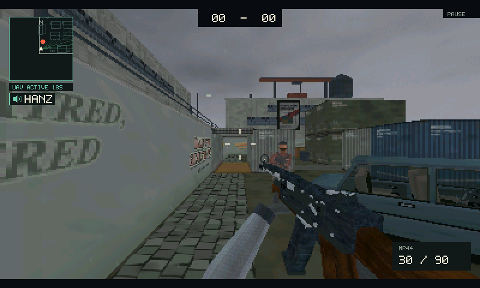
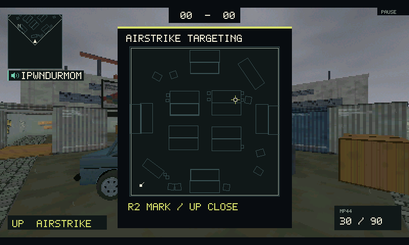

# Fall of Duty Lite

A compact first-person shooter for the Guition JC4880P443C_I_W ESP32-P4 handheld and SDL2 desktops. Fight an offline first-to-ten duel in Ship Box, a rain-soaked container yard. Choose from two rivals and ten difficulty levels. The game renders at 400×225 or 320×180 and presents at 800×480. The full game data takes 3.65 MB on microSD.

[Download v1.0.0 handheld package](https://github.com/AJ7-III/Fall-of-Duty-Lite/releases/tag/v1.0.0) · [Handheld setup](INSTALL.md) · [Play on desktop](#play-on-desktop) · [Board build and qualification](BOARD.md) · [Evidence and benchmarks](EVIDENCE.md)



## Inside Ship Box

- **Three weapons with first-person arms** — MP44 rifle, M40A3 bolt-action rifle with scope, and USP .45 sidearm with weapon motion tracks from the browser edition.
- **Killstreaks and rival voice comms** — Three consecutive kills activate UAV radar. Five unlock a targeted airstrike and seven unlock Apache support. The shared 27-line voice bank decodes mono 24 kHz IMA ADPCM on demand.
- **Enhanced software renderer** — Texture mipmaps, 16-bit reciprocal depth, a dithered sky cubemap, and a 1024×512 graffiti atlas, plus a `--look classic` mode for comparisons ([audio and rendering notes](QUALITY.md)).
- **Compact asset pack** — The checked-in schema 7 pack uses lossless storage compression, shared mesh vertices, and position-only animation poses.

## Handheld download and hardware

Grab the prebuilt v1.0.0 handheld package from the [GitHub release page](https://github.com/AJ7-III/Fall-of-Duty-Lite/releases/tag/v1.0.0) or download the archive directly.

- [Fall-of-Duty-Lite-Guition-ESP32-P4.zip](https://github.com/AJ7-III/Fall-of-Duty-Lite/releases/download/v1.0.0/Fall-of-Duty-Lite-Guition-ESP32-P4.zip)
- [Fall-of-Duty-Lite-Guition-ESP32-P4.zip.sha256](https://github.com/AJ7-III/Fall-of-Duty-Lite/releases/download/v1.0.0/Fall-of-Duty-Lite-Guition-ESP32-P4.zip.sha256)
- [Latest releases](https://github.com/AJ7-III/Fall-of-Duty-Lite/releases/latest)

The archive bundles the bootloader, partition table, application binary, schema 7 SD pack, reference replay traces, `INSTALL.md`, licenses, and `SHA256SUMS`. Keep the firmware and SD pack from the same archive together because schema 7 packs require firmware with schema 7 support.

| Component | Target profile |
| --- | --- |
| Board and SoC | Guition JC4880P443C_I_W with pre-v3 ESP32-P4 silicon (v0.0–v1.99 image range, 360 MHz CPU, 16 MB flash, 200 MHz PSRAM) |
| Display and touch | ST7701S DPI panel (800×480 presentation, selectable 400×225 and 320×180 world modes) and GT911 touch for menus and HUD pause |
| Audio and storage | ES8311 I²S speaker output and FAT32 microSD card over SDMMC (`/sd/fall-of-duty.fodp`) |
| Controller | Wired Sony DualShock 4 (`VID 054c`, `PID 05c4` or `09cc`) on the P4 high-speed USB host port |

Follow the [handheld installation guide](INSTALL.md) to verify `SHA256SUMS`, copy the contents of `sd/` to the root of a FAT32 microSD card, confirm the chip and flash ID with `esptool`, and flash `@flash_args`. Plug in the speaker and DualShock 4, boot, and pick **Start Duel** with Cross or touch.

> [!NOTE]
> The v1.0.0 handheld package is cross-built with ESP-IDF v5.5.3 and checked for flash layout and image checksums. Physical Guition JC4880P443C_I_W qualification is still pending. Display scanout, touch corners, USB controller handling, audio under scanout, optical latency, and full first-to-ten play on hardware remain to be verified using [BOARD.md](BOARD.md).

## Play on desktop

From the repository root, install CMake 3.22+, Ninja, a C++17 compiler, zlib 1.2.9+, and SDL2 development files. The checked-in `assets/fall-of-duty.fodp` pack is ready to run. On macOS, the Command Line Tools SDK supplies zlib, and Homebrew can install CMake, Ninja, and SDL2.

```sh
cmake -S . -B build/host -G Ninja -DCMAKE_BUILD_TYPE=Release
cmake --build build/host
ctest --test-dir build/host --output-on-failure
build/host/fod_host
```

Pass `--mode 320` to launch in compact resolution, `--look classic` to compare with the earlier visual path, or `--pack PATH` to load another `.fodp` file. Pass `-DFOD_DESKTOP=OFF` when configuring CMake for a headless CLI and test build without SDL2.

### Controls

SDL gamepads use the same layout as the handheld DualShock 4. On the Guition, touch works in menus and on the HUD pause button. Losing focus or disconnecting a controller pauses a desktop match. Resume explicitly when ready.

| Action | Keyboard and mouse | DualShock 4 and SDL gamepad |
| --- | --- | --- |
| Move | `W A S D` | Left stick |
| Look and airstrike cursor | Mouse | Right stick |
| Fire and mark airstrike | Left mouse | `R2` / Right trigger |
| Aim down sights | Right mouse or `Space` | `L2` / Left trigger |
| Sprint | `Shift` | `L3` / Left stick press |
| Jump | `Z` | `Cross` / `A` |
| Crouch (tap) or prone (hold) | `C` | `Circle` / `B` |
| Reload | `R` | `Square` / `X` |
| Swap weapon | `X` | `Triangle` / `Y` |
| Deploy banked streak or close laptop | `4` | `D-pad Up` |
| Confirm or start duel | `Enter` or click menu | `Cross` / `A` |
| Navigate menus | Arrow keys | `D-pad` |
| Back from Duel Setup | `Esc` or `P` | `Circle` / `B` |
| Pause or resume | `Esc` or `P` | `Options` / `Start` |

## Screenshots

| Start menu and duel setup | MP44 iron sights down long lane |
| --- | --- |
|  |  |

| M40A3 bolt-action rifle | Airstrike targeting laptop |
| --- | --- |
|  |  |

## Verification status

Host verification and cross-build checks are recorded in [EVIDENCE.md](EVIDENCE.md), while physical board tests follow [BOARD.md](BOARD.md#qualification-status).

| Area | Status | Summary |
| --- | --- | --- |
| Native test suite | Verified on desktop | `native_tests` and `platform_tests` pass in Release and sanitizer builds and finish first-to-ten duels against both rivals |
| Replay parity | Verified on desktop | Eight [reference fixtures](reference/fixtures) cover 3,076 steps. The geometry optimization produced 48 checkpoint images and 32 gameplay journals identical to the previous native build across both render modes. |
| Asset pack and memory | Verified on desktop | Schema 7 lossless compression cut pack size by 56.5% from 8,394,137 to 3,653,826 bytes across 14 byte-identical payloads, with 9,553,337 resident asset bytes and 9,635,257 estimated peak load bytes (12 MiB limit) |
| Desktop frame timings | Measured on desktop | Projection reuse reduced geometry setup p95 by 29–33% and whole-frame p95 by 1.6–14.6%, while the later runtime geometry pass lowered resident memory with an inconclusive frame-time spread between 2.3% faster and 0.1% slower |
| Firmware | Cross-build validated | ESP-IDF v5.5.3 produced an 851,552-byte application image. The release passed flash layout and checksum checks. |
| Guition hardware | Qualification pending | See the [on-device test procedure](BOARD.md#replay-and-measurement) for scanout, input, audio, latency, and full hardware duels. |

The Apache comparison has a known browser-to-native difference at tick 564 in the dead rival’s vertical root position. [See the replay evidence.](EVIDENCE.md#replay-fixtures)

## Replay, benchmarks, and testing

The repository includes eight [reference fixtures](reference/fixtures) covering long-lane combat, glass breakage, movement, weapon cycles, the airstrike laptop, the Apache fly-in, death timing, and match point. Run these commands from the repository root with the checked-in asset pack.

```sh
ctest --test-dir build/host --output-on-failure
build/host/fod_host --bench reference/fixtures/long-lane.fodtrace --mode both
build/host/fod_host --bench reference/fixtures/apache.fodtrace --mode both
python3 tools/run-evidence.py \
  --host build/host/fod_host --pack assets/fall-of-duty.fodp \
  --reference reference/fixtures --out out/evidence
```

### Headless CLI options

| Option | Effect |
| --- | --- |
| `--pack PATH` | Load a custom `.fodp` pack (defaults to `assets/fall-of-duty.fodp`) |
| `--mode 400\|320\|both` | Choose world resolution (`both` runs both sizes during `--bench`) |
| `--look enhanced\|classic` | Select the enhanced renderer or the earlier classic visual path |
| `--trace PATH` | Replay a `.fodtrace` recording headlessly |
| `--journal PATH` | Record per-tick simulation state as JSONL during `--trace` |
| `--bench PATH` | Measure per-stage timings (`--frames 3000` and `--warmup 300` by default) |
| `--image PATH` | Write an 800×480 PPM frame (pair with `--trace` and `--image-tick N` for a specific tick) |
| `--inspect` | Print JSON asset counts, memory estimates, source revision, and art seed |

## Asset export and firmware packaging

### Regenerate the asset pack

Only the optional export and browser capture tools require Node.js and Chromium. Use Node 20.19+, 22.13+, or 24+ within the version ranges in `package.json`.

```sh
npm ci
npx playwright install chromium
npm run data:check
npm run assets:export
```

The exporter writes `out/sd/fall-of-duty.fodp`. Pass that path to `build/host/fod_host --pack out/sd/fall-of-duty.fodp` to test a fresh export. Read [ASSET_PIPELINE.md](ASSET_PIPELINE.md) for the schema 7 layout, compression format, provenance, and optional browser baseline capture.

### Build and package handheld firmware

Follow the [ESP-IDF v5.5.3 board guide](BOARD.md) to build `firmware/build-lite` and activate the pinned SDK environment. Then package the handheld release from the repository root.

```sh
python3 tools/package-release.py \
  --firmware firmware/build-lite --idf "$IDF_PATH" \
  --sd assets --reference reference/fixtures \
  --out out/Fall-of-Duty-Lite-Guition-ESP32-P4.zip
```

The archive contains the bootloader, partition table, firmware application, SD files, replay traces, installation instructions, licenses, and SHA-256 checksums.

## Documentation and attribution

| Document | Contents |
| --- | --- |
| [INSTALL.md](INSTALL.md) | Handheld flashing steps, SD card setup, recovery flow, and DualShock 4 controls |
| [BOARD.md](BOARD.md) | ESP-IDF v5.5.3 build profile, display and input bring-up, on-device benchmarks, and qualification checklist |
| [QUALITY.md](QUALITY.md) | Audio mixing, IMA ADPCM voice bank, and enhanced renderer details |
| [EVIDENCE.md](EVIDENCE.md) | Asset compression numbers, memory accounting, desktop benchmarks, and replay parity results |
| [ASSET_PIPELINE.md](ASSET_PIPELINE.md) | Schema 7 pack format, geometry encodings, and optional browser baseline capture |
| [reference/browser/README.md](reference/browser/README.md) | Included browser snapshot that drives the asset exporter and gameplay data generator |

The companion browser project is [Fall of Duty](https://github.com/AJ7-III/Fall-of-Duty). See the [MIT license](LICENSE) and [third-party notices](THIRD_PARTY_NOTICES.md).
